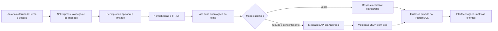

> **Atualização:** Gemini substituiu Claude. As instruções atuais de provedor, chave, consentimento e avaliação estão em [GEMINI.md](GEMINI.md). As métricas locais abaixo permanecem válidas; referências ao Claude descrevem a primeira versão.

# A.L.I.A — documentação técnica do PI, 2ª unidade

Versão: alia-v1 · 20/11/2026. Leia também [a auditoria](AUDITORIA_ANDREW.md), [o roteiro](APRESENTACAO.md) e [a operação](HOSPEDAGEM.md).

## 1. Problema

Fundadores iniciantes têm dúvidas sobre validação, proposta de valor, MVP, monetização e apresentação. Um diretório de contatos não os ajuda, sozinho, a decidir o próximo experimento. A A.L.I.A organiza essas dúvidas em orientações acionáveis dentro do Nexhub. Não decide investimentos nem comprova viabilidade empresarial.

## 2. Objetivo

Receber um desafio em linguagem natural, recuperar orientações relevantes e apresentar ações com critérios observáveis. O beneficiário principal é a startup; mentores e investidores podem usar a ferramenta com um caso descrito na pergunta. O perfil automático é exclusivamente o da startup pertencente à conta autenticada.

Há dois modos claramente identificados:

- **Local, funcional sem chave externa:** recuperação de informação por TF-IDF e similaridade cosseno; devolve trechos editoriais e estrutura predefinida. É processamento de linguagem/recuperação textual, não um LLM treinado pela equipe.
- **Claude, opcional:** integração com LLM externo para gerar análise estruturada, com pergunta, perfil autorizado e orientações recuperadas. Não foi avaliado com respostas reais nesta entrega porque a equipe ainda não possui chave/créditos. Testes do adaptador usam respostas simuladas e não provam qualidade do modelo.

## 3. Arquitetura



Vercel serve React/Vite. Render executa a API Node/Express e o motor local. Supabase armazena o histórico. No modo Claude, a inferência acontece na Anthropic; não hospedamos os pesos do modelo no Render.

## 4. Dados

Base: 12 orientações editoriais em `nexhub-api/src/ai/knowledge.ts`, duas para cada um dos seis temas. Campos: identificador, tema, título, termos de busca, orientação e critério de medição. Foram redigidas durante esta implementação com assistência de IA; não são pesquisas de mercado, citações de especialistas ou exemplos de empresas reais. Precisam de revisão da equipe e de um mentor antes de uso amplo.

Entrada: pergunta de 15 a 4.000 caracteres, tema explícito e modo. Perfil opcional: nome (120 caracteres), até seis setores, estágio (80), descrição (2.000) e até oito necessidades. Não enviamos automaticamente e-mail, telefone, senha, documentos, canvas privado, contatos de clientes ou finanças. Dados pessoais digitados na própria pergunta não são automaticamente anonimizados; a interface orienta a não incluí-los.

Avaliação: 24 perguntas sintéticas com orientação esperada, escritas para cobrir os temas. São casos de desenvolvimento, sem amostra independente de usuários. Não há dados rotulados de sucesso de startups nem treinamento supervisionado.

## 5. Tecnologias

React, Express, TypeScript, PostgreSQL/Supabase, Prisma, Zod, TF-IDF e similaridade cosseno implementados em TypeScript. Integração opcional por HTTP com a Messages API da Anthropic. Modelo padrão configurável: `claude-sonnet-5-5`; a disponibilidade depende da conta/provedor.

## 6. Justificativa e alternativas

Uma FAQ fixa é barata, mas exige que o usuário encontre a pergunta adequada. A busca por contagem de palavras é uma referência simples. TF-IDF atribui menor peso a termos frequentes e maior peso aos mais distintivos, permitindo ranquear orientações com custo pequeno e explicar os resultados.

Um LLM pode contextualizar melhor e escrever respostas novas, mas exige créditos, conexão externa e validação contra alucinações. O modo local é transparente e previsível, porém limitado lexicalmente. Não há evidência de que Claude supera TF-IDF neste projeto: a comparação generativa ainda não foi executada.

Não há justificativa, neste conjunto pequeno, para treinar rede neural, classificador de sucesso empresarial ou agrupamento K-Means. Não alegamos cross-validation, fine-tuning ou otimização de hiperparâmetros.

## 7. Preparação e representação

1. Remover acentos, converter para minúsculas e extrair tokens alfanuméricos.
2. Excluir tokens de um caractere e uma lista curta de palavras frequentes em português.
3. Construir vocabulário com os documentos editoriais, nunca com os rótulos da avaliação.
4. Calcular `idf(t) = ln((1 + N)/(1 + df(t))) + 1`, com N=12.
5. Peso do termo presente: `(1 + ln(contagem)) × idf`.
6. Calcular cosseno entre vetor da consulta e vetor de cada orientação.
7. Filtrar pelo tema selecionado e recuperar no máximo duas orientações. Empates são resolvidos pelo identificador.

No modo local, descrição e setores autorizados podem complementar a consulta. No modo Claude, a recuperação usa a pergunta e o tema; os campos autorizados são enviados separadamente. Campos vazios continuam ausentes/vazios, sem imputação de faturamento, clientes ou tração. Sem similaridade positiva, o modo local avisa que está mostrando apenas orientação geral.

Não usamos embeddings neurais. TF-IDF é uma representação vetorial esparsa lexical. Similaridade de 80% não significa 80% de chance de investimento, sucesso ou correção.

## 8. Implementação

- `GET /api/alia/me`: temas, disponibilidade de Claude, cota e vinte análises recentes da própria conta.
- `POST /api/alia/analyze`: pergunta, tema, `mode` e `useProfile`. Não aceita identificador de outro usuário/startup.
- `DELETE /api/alia/history`: apaga conteúdo de perguntas/respostas da conta, preservando registros técnicos de uso.
- `PATCH /api/preferences/ai`: autorizações. O consentimento externo é novo, separado e inicialmente falso.

Cada análise é independente; o histórico não é enviado como conversa ao modelo. A saída tem `summary`, `actions` (título, detalhe e métrica), `missingInformation` e `limitations`. O frontend apresenta cartões, fontes editoriais, modelo, versão e tempo, sem executar HTML da resposta.

A tabela `nexhub.AiAnalysis` registra dono, tema, modo, pergunta, resultado, status, modelo, versão, tokens e duração. A autenticação reaproveita o JWT do Nexhub com emissor, audiência, versão de sessão e conta ativa. Migrations aditivas não substituem tabelas existentes.

Claude: limite pessoal de cinco análises por dia e global padrão de cinquenta tentativas/dia; reserva serializada no banco antes de chamar a API. Falhas devolvem a cota pessoal, mas contam no teto global porque podem ter custo externo. Timeout de 45 segundos, sem repetição automática. Até 2.400 tokens de saída. O dia usa UTC−3. Não há promessa de uso ilimitado nem cobrança de assinatura nesta versão acadêmica. O modo local tem limite de cem análises/dia/conta.

## 9. Avaliação

Comandos a partir da raiz do repositório:

```powershell
npm run test:alia --prefix nexhub-api
npm run evaluate:alia --prefix nexhub-api
```

Critério inicial: Top-1 de pelo menos 75% nos casos de desenvolvimento. Top-1 é a fração em que a orientação esperada aparece primeiro; Hit@2, a fração em que aparece entre os dois primeiros. A avaliação principal pesquisa a base inteira, evitando que a escolha do tema torne a recuperação trivial. Também se registra Top-1 com filtro de tema.

Baseline: contagem de termos coincidentes, sem IDF, nos mesmos campos usados pela solução (descritores, título e orientação), com o mesmo desempate por identificador. A comparação controla dados e consultas, mas não isola somente o IDF: o cosseno e a ponderação de frequência também diferem. Não houve teste estatístico.

Os testes de engenharia cobrem normalização, ranking, pergunta fora de vocabulário, estrutura de saída, minimização do perfil, validação, consentimento, propriedade do histórico, limites e falhas externas. As rotas usam banco simulado nos testes automatizados. A interface foi exercitada com respostas locais reais do motor e API simulada, em desktop e 390px, incluindo recarregamento e exclusão do histórico.

## 10. Resultados

Evidência reproduzível: `nexhub-api/evaluation/results/local.json` contém perguntas identificadas, resultados, métricas e respostas locais.

| Medida | Resultado |
|---|---:|
| Top-1 TF-IDF, sem filtro de tema | 23/24 = 95,83% |
| Hit@2, sem filtro de tema | 23/24 = 95,83% |
| Top-1 com tema escolhido | 23/24 = 95,83% |
| Baseline de palavras | 22/24 = 91,67% |

A meta de desenvolvimento foi atingida. A diferença de 4,17 pontos percentuais é descritiva e não comprova generalização. O conjunto é pequeno, sintético e próximo do vocabulário editorial.

Erro p04: “Posso afirmar no deck que temos mil clientes sem ter medido isso?” esperava orientação sobre evidências, mas recuperou o roteiro geral de pitch primeiro. Isso mostra a dificuldade de busca lexical em entender a intenção de uma paráfrase. Não modificamos o conjunto para esconder o erro.

Claude: sem resultados reais ou notas de qualidade atribuídas. O runner opcional existe, mas exige chave e revisão humana:

```powershell
cd nexhub-api
npm run evaluate:alia -- --claude
```

Esse comando chama o provedor seis vezes, uma por tema, e pode gerar cobrança. O relatório deixa `humanReview` como PENDENTE. Avaliar cada resposta de 0 a 2 em: relevância, vínculo com contexto/fontes, ação mensurável, honestidade sobre lacunas e clareza. Meta proposta: pelo menos 8/10 em cinco dos seis casos e nenhuma invenção grave de fatos. Registrar duas avaliações humanas, desacordos e justificativas. Ainda é meta, não resultado.

## 11. Integração e valor

A página autenticada `/alia` está acessível nas áreas de startup e profissionais. Mostra qual modo está ativo, permite escolher um tema e incluir somente o perfil próprio autorizado. O usuário recebe um próximo experimento e um critério para decidir o que fazer depois. Não substitui mentoria; ajuda a preparar a conversa com mentor/investidor.

O recurso de editais recebido foi analisado separadamente: ordenação por interseção de áreas é regra, não IA treinada. Foi aproveitada a abertura de endereço HTTPS no modelo `Program` existente, sem criar tabelas paralelas incompatíveis.

## 12. Limitações

Base editorial pequena, não validada por especialistas; consultas sintéticas; reconhecimento lexical limitado de sinônimos, negações e intenções; nenhuma validação com usuários reais. O modo local produz orientações reaproveitadas, não conversa aberta. Perfil insuficiente limita personalização. O histórico não é memória conversacional. Sem busca na web ou verificação de editais/concorrentes atuais.

Claude depende de configuração, saldo e disponibilidade; pode alucinar mesmo com prompt restritivo. Validar JSON garante formato, não veracidade. A defesa textual contra prompt injection não oferece garantia absoluta. Não há ferramentas que permitam ao modelo modificar o banco ou agir pelo usuário. Os prompts podem conter dados digitados voluntariamente. Exclusão no Nexhub não equivale a exclusão de logs do provedor. Não há expiração automática do histórico nesta versão; o usuário pode apagar seu conteúdo.

## 13. Próximos passos

Revisar a base com mentor, ampliar a coleção e recolher perguntas reais com consentimento. Criar conjunto independente e revisar rótulos às cegas; testar sinônimos e perguntas fora de domínio. Ampliar a comparação com diferentes representações, mantendo os mesmos campos e consultas. Depois, avaliar embeddings semânticos e só então decidir se justificam custo/complexidade. Ativar Claude com orçamento baixo, executar a rubrica e documentar erros, latência e tokens reais. Implementar retenção automática e exportação do histórico se necessário.

## Evidências da Camada 2

- **Feature engineering / pipeline:** tokens, pesos TF-IDF, cosseno, preparação e seleção descritos acima; código em `src/ai/core.ts`.
- **Comparação:** baseline lexical e ranking TF-IDF, com limitação de controle explicitada.
- **LLM:** propósito, provedor, entrada, prompt versionado, formato, validação e plano de avaliação disponíveis; geração real pendente.
- **Recuperação aumentada do modo Claude:** até dois documentos editoriais, cada orientação é uma unidade completa (sem corte arbitrário); recuperação lexical, sem modelo de embeddings. Não apresentar como RAG semântico ou como treinamento com documentos. Fontes recuperadas ficam visíveis; vínculo factual da geração exige revisão humana.
- **Não aplicáveis:** regressão/classificação supervisionada, clusters, redes treinadas, desbalanceamento, cross-validation e busca de hiperparâmetros. O professor exige coerência, não todas as técnicas.

## Referências técnicas

- [Representação de texto — scikit-learn](https://scikit-learn.org/stable/modules/feature_extraction.html#text-feature-extraction). Referência conceitual; a implementação é TypeScript, não usa scikit-learn.
- [Similaridade cosseno — scikit-learn](https://scikit-learn.org/stable/modules/metrics.html#cosine-similarity).
- [Messages API — Anthropic](https://platform.claude.com/docs/en/api/messages/create).
- [Modelos — Anthropic](https://platform.claude.com/docs/en/models/overview).
- Enunciado do professor preservado em [REQUISITOS_PROFESSOR.txt](REQUISITOS_PROFESSOR.txt).
